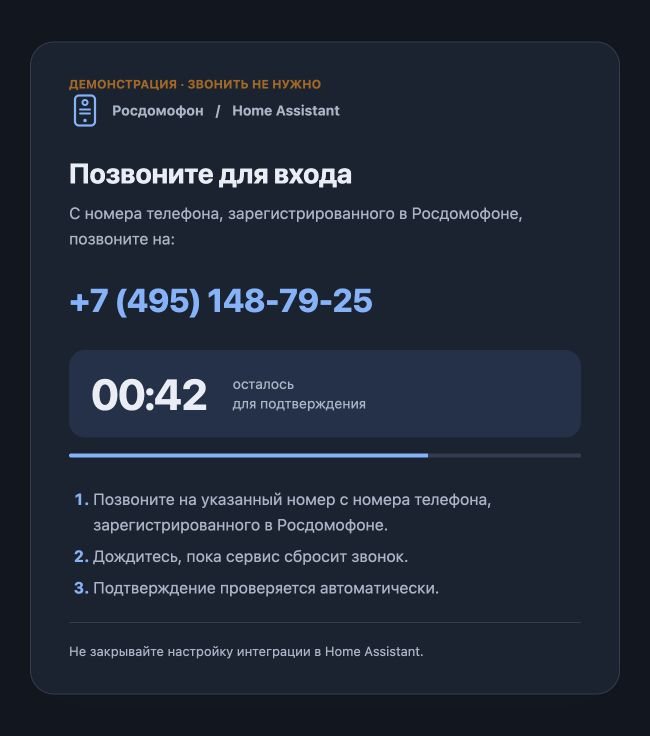
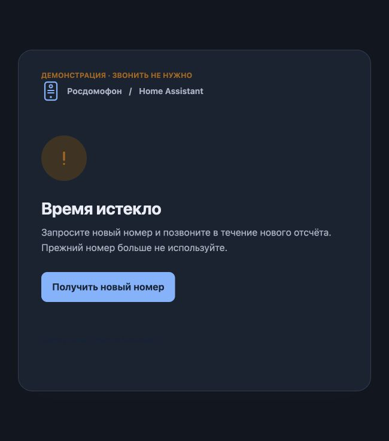
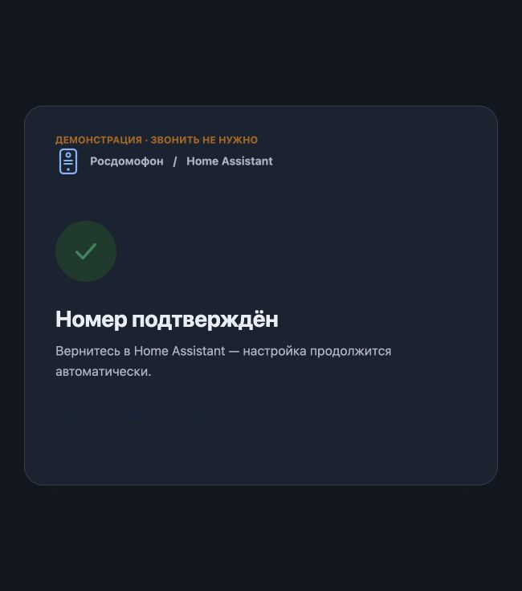

# Интеграция Росдомофон для Home Assistant

**Адаптированный форк интеграции [iljyxa/rosdomofon-ha](https://github.com/iljyxa/rosdomofon-ha), автор оригинала — [iljyxa](https://github.com/iljyxa).** Спасибо автору за исходную интеграцию и проделанную работу. Доработки этого форка публикуются от имени **whitedictator**; исходная лицензия MIT и история проекта сохранены.

### Авторизация по звонку вместо SMS

Интеграция адаптирована под новый способ авторизации Росдомофона: **подтверждающий звонок**. Home Assistant показывает номер, на который нужно позвонить с зарегистрированного в Росдомофоне телефона, и **таймер обратного отсчёта**. После звонка вход подтверждается автоматически. Если не успели — есть кнопка **«Получить новый номер»**.

### Уведомление о входящем звонке

Добавлен **датчик «Росдомофон: входящий звонок»** и событие для сценариев HA: можно показывать уведомления, включать свет или выводить экран домофона. Приём push работает непосредственно на стороне Home Assistant, без постоянно подключённого телефона. **Пока экспериментально:** настоящий входящий звонок с панели ещё предстоит проверить.

Управление дверями, шлагбаумами и воротами, камеры и гостевые ссылки исходной интеграции сохранены.

## Возможности

- **Управление замками** — замки Росдомофон как сущности типа `lock` в Home Assistant.
- **Поддержка нескольких типов устройств**: дверь подъезда, шлагбаум, ворота, калитка (отдельные сущности с разными иконками).
- **Гостевые ссылки** — генерация временных ссылок для открытия двери гостям без доступа к Home Assistant.
- **Камеры видеонаблюдения** — просмотр HLS потоков с камер Росдомофон в интерфейсе Home Assistant.

## Требования

- Home Assistant **2026.8+** (проверено на 2026.10.4).
- Аккаунт в сервисе **Росдомофон** с привязанным номером телефона РФ.
- Установленный **HACS** (Home Assistant Community Store).

## Установка через HACS

1. Откройте **HACS → Integrations** в интерфейсе Home Assistant.
2. Нажмите кнопку **⋮ (три точки)** в правом верхнем углу и выберите **Custom repositories**.
3. В поле **Repository** укажите URL репозитория:
   - `https://github.com/whitedictator/rosdomofon-ha`
4. В поле **Category** выберите **Integration** и нажмите **Add**.
5. Найдите интеграцию **Росдомофон** в списке HACS.
6. Нажмите **Install** и перезагрузите Home Assistant.

## Настройка интеграции

1. Перейдите в **Настройки → Устройства и службы → Добавить интеграцию**.
2. Найдите **Росдомофон** (или `rosdomofon`).
3. Выберите **«По звонку (рекомендуется)»** и введите номер телефона, зарегистрированный в Росдомофоне.
4. Откроется страница Home Assistant с номером для звонка и обратным отсчётом. **Позвоните на указанный номер с номера телефона, зарегистрированного в Росдомофоне.** Дождитесь, пока сервис сбросит звонок.
5. Интеграция автоматически проверит подтверждение и завершит вход. Вводить SMS-код или извлекать токен из приложения не нужно.
6. Если время истекло, нажмите **«Получить новый номер»**. Страница запросит новое подтверждение и запустит новый отсчёт. Используйте номер из нового запроса — сервис может выдать как другой, так и прежний номер.

SMS и вход по готовому refresh_token сохранены как дополнительные способы. Доступность способов авторизации зависит от сервиса и аккаунта. Перезапрос ограничен тремя попытками в одном сеансе; при ограничении со стороны сервиса предусмотрена пауза.

Если исходная интеграция уже установлена, сделайте резервную копию HA и замените её источник в HACS на этот форк. Домен остаётся `rosdomofon`: устанавливать обе версии одновременно нельзя. Имеющиеся настройки интеграции используются повторно.

## Что изменено в форке

Форк **whitedictator** основан на интеграции уважаемого автора **[iljyxa](https://github.com/iljyxa/rosdomofon-ha)**. Спасибо автору за исходную работу: управление замками, камеры и гостевые ссылки сохранены.

Интеграция адаптирована под новый способ авторизации Росдомофона — подтверждающий звонок вместо SMS. Для входа нужно позвонить на номер, который показывает сама интеграция. На странице видны номер, оставшееся время, результат проверки и кнопка перезапроса.

Дополнительно добавлен экспериментальный приём уведомлений о входящем звонке непосредственно в HA, без постоянного подключения Android. Его можно использовать в сценариях Home Assistant: показать уведомление, включить свет, открыть нужную панель или отправить событие на информационный экран.

**Версия 1.5.0b1 — предварительная.** Вход через настоящий подтверждающий звонок проверен. Страница, таймер, перезапрос и завершение потока настройки проверяются локальными автоматическими тестами. Подписка push подключается, однако реальный входящий звонок с панели и завершение такого звонка ещё предстоит проверить; не используйте этот датчик как единственный способ оповещения о посетителях.

## Входящий звонок и сценарии HA

При включённом параметре **«Входящие звонки»** создаётся бинарный датчик **«Росдомофон: входящий звонок»**. Во время звонка он принимает состояние `on`, после завершения — `off`. При недоступности приёмника датчик становится недоступным. Параметр можно изменить в настройках интеграции.

Точное имя сущности посмотрите в HA; в примере замените его своим:

```yaml
alias: Росдомофон — уведомление о звонке
triggers:
  - trigger: state
    entity_id: binary_sensor.rosdomofon_vkhodiashchii_zvonok
    from: "off"
    to: "on"
actions:
  - action: persistent_notification.create
    data:
      title: "Звонок в домофон"
      message: "Кто-то звонит в дверь подъезда."
mode: single
```

Для более сложных сценариев доступно событие `rosdomofon_call_state`: `state` (`ringing` / `ended`), `entity_id` соответствующего замка, `call_id`, `entry_id`, `time`, `expires`, `reason`. Событие звонка само по себе **не открывает дверь**. Для открытия используйте штатное действие `lock.unlock` по своему решению.

HA необходим постоянный доступ к облаку Росдомофона и push-сервису. При отсутствии сигнала завершения звонка применяется ограничение длительности ожидания. Телефон и отдельный сервер для авторизации или получения push не требуются.

## Страница входа

Скриншоты сделаны с настоящим HTML и обработчиком перезапроса интеграции, но с тестовым ответом сервиса; на демонстрационные номера звонить не нужно.





## Гостевые ссылки (Поделиться)

Интеграция позволяет создавать временные ссылки для открытия двери гостями без доступа к Home Assistant.

### Кнопка «Поделиться»

Для каждого замка автоматически создаётся кнопка `button.rosdomofon_share_<id>`. При нажатии:

1. Генерируется уникальная ссылка со сроком действия **12 часов**.
2. Ссылка отображается в уведомлении Home Assistant — скопируйте её и отправьте гостю.
3. Гость переходит по ссылке в браузере — открывается страница с кнопкой «ОТКРЫТЬ» и информацией о том, сколько ещё действует ключ.
4. При нажатии на кнопку на странице выполняется попытка открыть замок; при успехе гость видит статус «ОТКРЫТО», при ошибке — «ОШИБКА» и текст ошибки.
5. По истечении срока ссылка автоматически деактивируется.

### Сервис `rosdomofon.generate_share_link`

Альтернативно можно вызвать сервис из автоматизаций или инструментов разработчика:

```yaml
service: rosdomofon.generate_share_link

  entity_id: lock.rosdomofon_12345_1
  ttl_hours: 12
```

Параметры:

| Параметр    | Описание                               | По умолчанию |
|-------------|----------------------------------------|--------------|
| `entity_id` | Entity ID замка Росдомофон             | Обязательный |
| `ttl_hours` | Срок действия ссылки в часах (0.5–168) | 12           |

### Требования для гостевых ссылок

- Должен быть настроен **внешний доступ** к Home Assistant (External URL или Nabu Casa).
- Если внешний доступ не настроен, при нажатии кнопки появится уведомление с инструкцией.

### Безопасность

- Каждая ссылка содержит уникальный UUID и не требует авторизации в HA.
- Ссылка автоматически деактивируется по истечении срока.
- При выгрузке / удалении интеграции все активные ссылки отзываются.
- Рекомендуется использовать HTTPS для внешнего доступа.

## Камеры видеонаблюдения

Интеграция автоматически обнаруживает камеры, привязанные к вашему аккаунту Росдомофон, и создаёт для них сущности типа `camera`.

### Возможности камер

- Просмотр живого HLS потока в интерфейсе Home Assistant
- Автоматическая авторизация запросов через встроенный прокси-сервер
- Поддержка просмотра через веб-интерфейс и мобильные приложения Home Assistant
- Интеграция с картами (Lovelace) и панелями мониторинга
- Снимки (thumbnails) для карточек и уведомлений — без ожидания раскачки потока

### Технические требования

#### Для локального просмотра
- Браузер с поддержкой HLS (Safari, Edge) или расширение для Chrome/Firefox
- Home Assistant должен быть доступен по HTTPS (для корректной работы медиа-потоков)

#### Для удалённого просмотра
- Настроенный **внешний доступ** (External URL) или **Home Assistant Cloud** (Nabu Casa)
- HTTPS соединение (обязательно для безопасной передачи видео)

### Как работает прокси

Для просмотра потоков с камер Росдомофон требуется авторизация по Bearer токену. Интеграция автоматически:

1. Перехватывает запросы к HLS потокам камер
2. Добавляет заголовок `Authorization` с актуальным токеном
3. Переписывает URL в плейлистах для корректной работы
4. Возвращает поток клиенту

Дополнительно каждый URL прокси подписывается собственной HMAC-SHA256 подписью (без срока действия — секрет генерируется при старте Home Assistant), чтобы стрим-воркер и WebRTC-провайдер (go2rtc) могли обращаться к потоку без логина в UI. В отличие от штатной подписи Home Assistant (`async_sign_path`) она не протухает — это важно, потому что HA удерживает URL внутри объекта `Stream` на всё время открытого live-просмотра, порой намного дольше нескольких минут.

Всё это происходит прозрачно — вам не нужно ничего настраивать вручную.

### Снимки камер

Снимок (для карточек на дашборде, уведомлений, сервиса `camera.snapshot`) захватывается коротким запуском `ffmpeg` по факту запроса — decode ровно до первого кадра и выйти — через собственный прокси. Результат кэшируется на несколько секунд, чтобы несколько запросов подряд (пара карточек одной камеры, история) не плодили несколько параллельных запусков `ffmpeg`. Никакого фонового процесса нет — `ffmpeg` работает только те секунды, что реально нужны для захвата кадра, а не постоянно, пока камера добавлена в Home Assistant.

Это требует настроенного в Home Assistant компонента `ffmpeg` (обычно уже включён по умолчанию).

### Использование в картах Lovelace

```yaml
type: picture-glance
camera_image: camera.rosdomofon_camera_39167
entities:
  - lock.rosdomofon_entrance_door
  - button.rosdomofon_share_entrance_door
```

Или для просмотра потока:

```yaml
type: custom:webrtc-camera
entity: camera.rosdomofon_camera_39167
```

## Примеры автоматизаций

### Автоматическое создание гостевой ссылки по расписанию

```yaml
automation:
  - alias: "Гостевая ссылка для курьера"
    description: "Создаёт временную ссылку каждое утро для курьера"
    trigger:
      - platform: time
        at: "09:00:00"
    condition:
      - condition: time
        weekday:
          - mon
          - tue
          - wed
          - thu
          - fri
    action:
      - service: rosdomofon.generate_share_link
        
          entity_id: lock.rosdomofon_entrance_door
          ttl_hours: 2
      - service: notify.telegram
        
          message: "Ссылка для открытия двери создана и действует до 11:00"
```

## Отладка и диагностика

Интеграция использует логгер `custom_components.rosdomofon`. Для подробной диагностики:

```yaml
logger:
  default: warning
  logs:
    custom_components.rosdomofon: debug
```

## Безопасность

- Все запросы к API Росдомофон используют HTTPS
- Токены доступа хранятся в защищённом хранилище Home Assistant
- Гостевые ссылки содержат уникальный UUID и автоматически истекают
- Рекомендуется использовать HTTPS для внешнего доступа к Home Assistant
